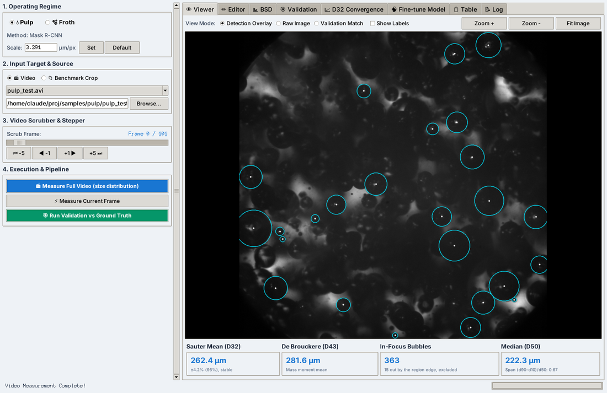

# BubbleMetrix

Bubble size measurement for flotation video, built during a UNSW Taste of Research placement (2026), School of Minerals and Energy Resources Engineering, supervised by Prof Seher Ata.

- **Pulp zone:** Mask R-CNN trained on hand-labelled probe frames. On 8 unseen operating conditions (leave-one-clip-out) it reaches recall 0.92 ± 0.06 and D32 within 1.5% on average (ratio 0.99 ± 0.03).
- **Froth zone:** Cellpose-SAM used zero-shot. Recall 0.86 and local precision 0.98 on hand-outlined bubbles; D32 2.16 mm on the test column.
- **Desktop app:** one button measures a whole video and reports D32 with a 95% interval. It stops once D32 is known to ±5%, scores the model against hand labels, and fine-tunes it on new footage with a before/after check.

## Quick start (Windows)

1. Install Python 3.12.
2. Put `best.pt` from **Releases** in `BubMask\runs\rr_full_e20\`.
3. Double-click `INSTALL.bat` (once).
4. Double-click `launch_gui.bat`.

Full guide: **[docs/MANUAL.md](docs/MANUAL.md)**.

## What's here

| Folder | Contents |
|---|---|
| `bubble_gui.py`, `bubble_gui_teach.py`, `engines/` | the app: detection engines, measurement, D32 convergence, fine-tuning |
| `BubMask/` | pulp Mask R-CNN: code (`bubble_rcnn/`), labels, split, evaluation and cross-validation results |
| `Froth/` | Cellpose worker and fine-tuning, froth labels, scoring harness, D32 convergence study |
| `report/` | report and poster kit (all numbers with sources), figures, overlays, results deck, Faculty template |
| `docs/` | user manual |

Not in git: model weights (Release asset), source videos, training images (`BubMask/data/crops/`), Python environments, and superseded work (`progress/` on the project drive).
