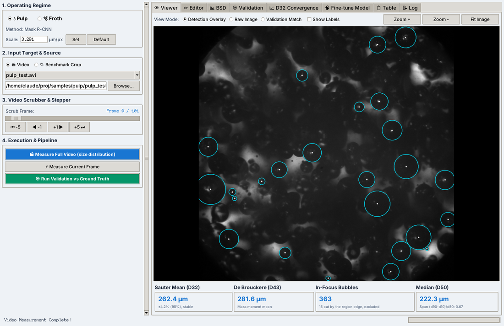
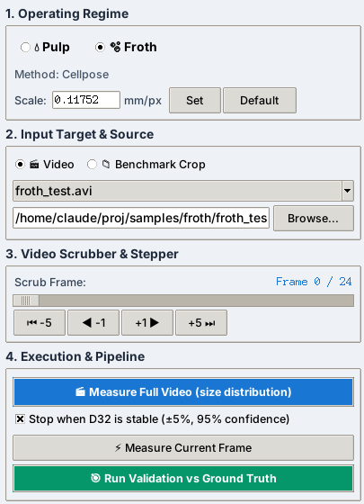
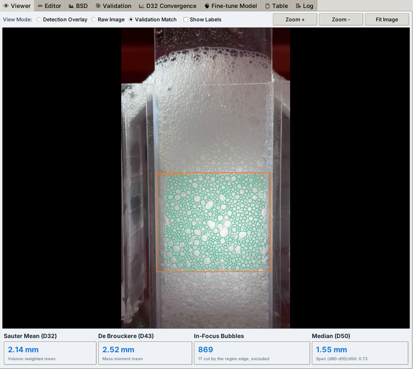
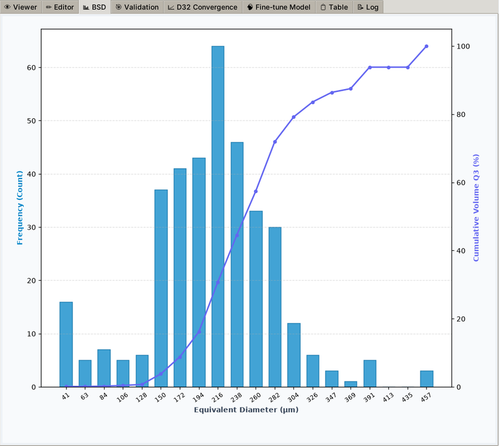
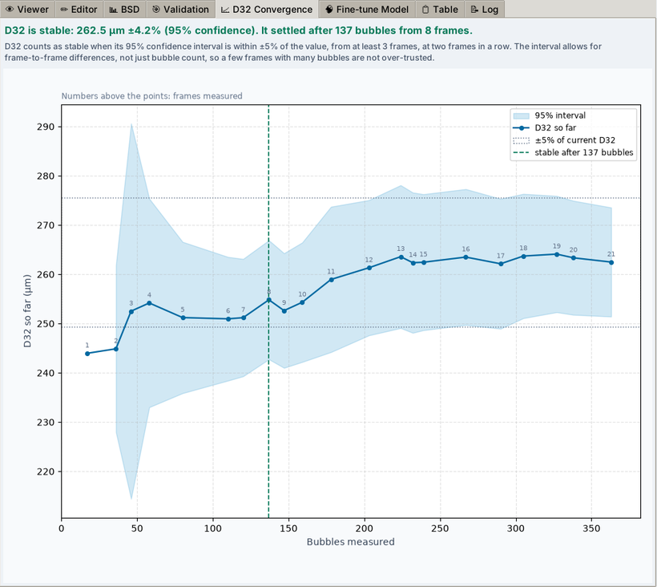
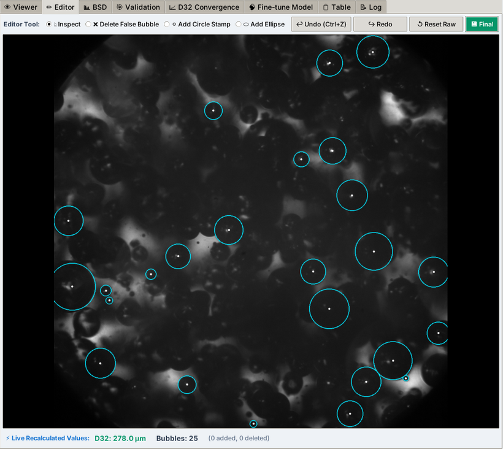
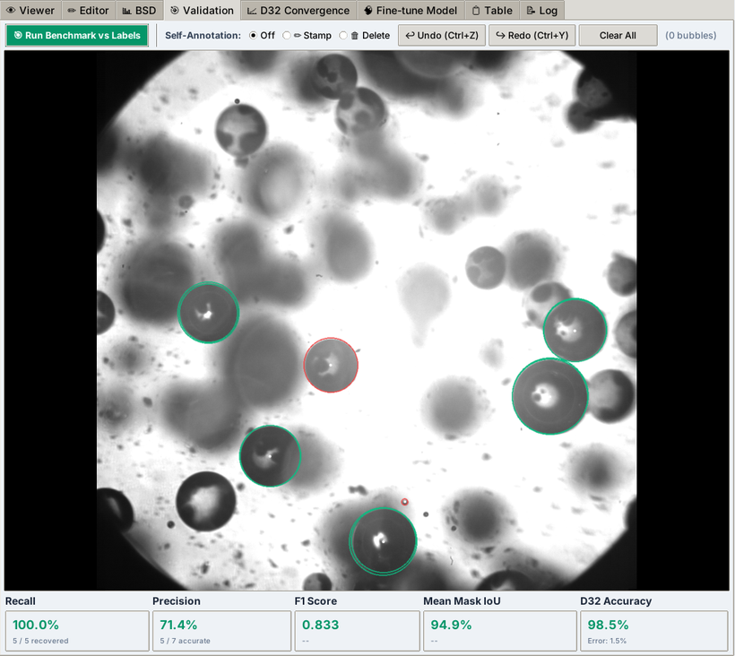
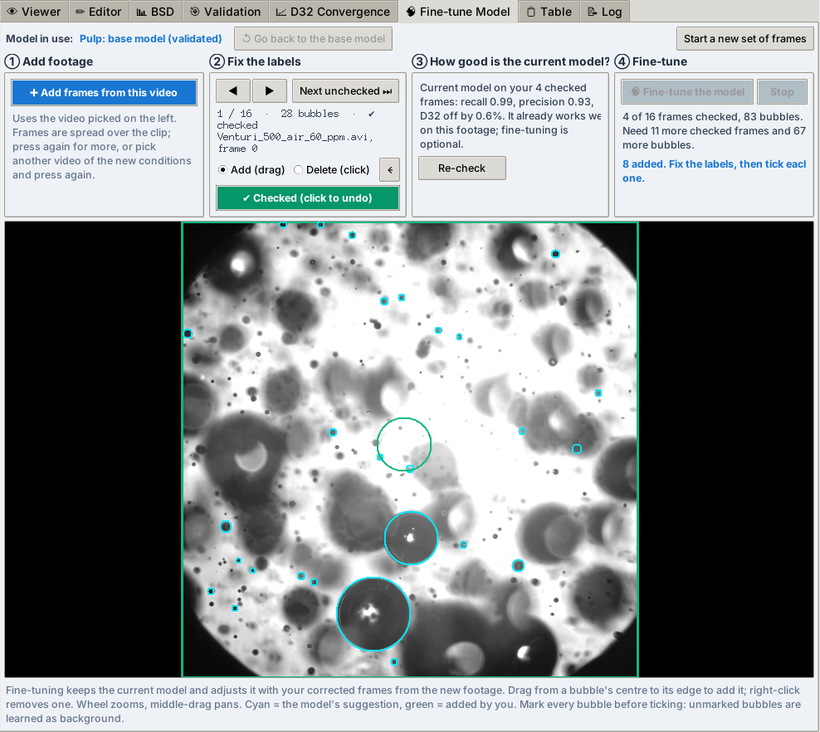

# BubbleMetrix user manual

BubbleMetrix measures bubble sizes from flotation video and reports the Sauter mean diameter (D32) and the size distribution.

- **Pulp:** probe video, measured with Mask R-CNN.
- **Froth:** column video, measured with Cellpose.

It runs on a normal Windows laptop. No GPU is needed, and there are no settings to tune.



---

## 1. Install (once)

You need Windows 10/11, **Python 3.12** ([python.org](https://www.python.org/downloads/), tick *Add to PATH*) and about 4 GB of free disk space.

1. **Get the code.** Unzip `BubbleMetrix.zip`, or on the GitHub page press **Code → Download ZIP** (or use `git clone`).
2. **Check the pulp model.** The zip already contains it. From GitHub, download `best.pt` (184 MB) from the repo's **Releases** page. Either way it must be here:
   ```
   BubMask\runs\rr_full_e20\best.pt
   ```
3. **Double-click `INSTALL.bat`.** It builds two Python environments: one for the app and pulp, one for Cellpose/froth. This takes 10–20 minutes the first time.
4. **Add your videos** (optional). Copy them into `samples\pulp\` or `samples\froth\` so they appear in the list. **Browse…** also opens any file.

The froth model (Cellpose-SAM) downloads by itself the first time you measure froth.

## 2. Start

Double-click **`launch_gui.bat`**. If froth mode says Cellpose is missing, run `Froth\setup.ps1` (or `INSTALL.bat` again).

## 3. The left panel



**1. Operating Regime.** Pick **Pulp** or **Froth**. This sets the model and the units (pulp in µm, froth in mm).

**Scale.** Type a value and press **Set**. **Default** goes back to:
- Pulp: 3.291 µm/px (provisional; from the quoted field of view).
- Froth: measured on every frame from the 55 mm *inner* tube width.

Changing the scale re-expresses results already on screen; nothing is re-run.

Press Enter in the box to apply a value without clicking **Set**.

**2. Input Target & Source.**
- **Video**: pick a clip from the list or **Browse…**.
- **Benchmark Crop**: hand-labelled test images, used for validation.

**3. Video Scrubber & Stepper.** Drag the slider or use **−5 / −1 / +1 / +5** to move between frames.

**4. Execution & Pipeline.**
- **Measure Full Video (size distribution)**: the main button (see §4).
- **Stop when D32 is stable**: froth only (pulp measures every frame, so there is nothing to stop).
- **Measure Current Frame**: only the frame on screen. Froth takes ~40 s; if you move to another frame meanwhile, the result is kept for its own frame and shown when you go back.
- **Run Validation vs Ground Truth**: scores the model against hand labels (§6).

<br clear="right">

## 4. Measure a video

1. Choose the regime and the video.
2. Press **Measure Full Video**.

| | Pulp | Froth |
|---|---|---|
| Frames with outlines | every frame | up to 40 frames spread over the clip |
| Frames used for D32 | every 5th frame (bubbles repeat between consecutive frames) | the same frames |
| Stops early? | no | yes, once D32 is stable (tick box) |
| Time on a laptop | ~6 min for a 101-frame clip | ~40 s per frame, usually 6–7 frames |

The four cards under the image show:
- **D32**, with its 95% interval and whether it is stable. Below 30 bubbles it says *Few bubbles: pool more frames* instead: D32 is volume-weighted, so a few large bubbles set it.
- **D43**.
- **Bubbles**: the count used, and how many were excluded (e.g. cut by the region edge).
- **D50** (median), with the span (d90 − d10)/d50.

**What counts as a bubble:**
- **Pulp:** in-focus bubbles of 12 px or larger, inside the circular field of view.
- **Froth:** bubbles inside the in-focus band (orange box).
- In both, bubbles cut by the edge of the measured region are excluded.



## 5. Results tabs

**Viewer.** Shows the frame with its outlines. Step through frames and each frame shows only its own bubbles; frames that were not sampled show none.
- **View Mode**: **Detection Overlay** (outlines), **Raw Image** (no outlines), or **Validation Match** (colours from the last validation run).
- **Zoom ± / Fit Image**, or the mouse wheel, to zoom. Right-drag to pan.
- **Show Labels** numbers the bubbles (the numbers match the Table).

**BSD.** Bars show the bubble count per size class. The line is the cumulative *volume* (Q3), the share of the total gas volume in bubbles up to that size. Where Q3 rises steeply is the size range that holds most of the gas.



**D32 Convergence.** Answers "have I measured enough?" The line shows D32 as bubbles are added, and the band is its 95% interval. **Stable** means the interval is within ±5% of D32, from at least 3 frames, two frames in a row. If D32 is not stable, the banner says roughly how many more bubbles are needed; pooling another clip of the same condition is the usual fix.



**Editor.** Fix one frame by hand. Pick an **Editor Tool**:
- **Inspect**: hover over or click a bubble to see its values, without changing anything.
- **Delete False Bubble**, then click a bubble.
- **Add Circle Stamp / Add Ellipse**, then drag from the centre to the edge.

**Undo (Ctrl+Z)** and **Redo (Ctrl+Y)** step through your changes. **Reset Raw** goes back to the model's original detections. The **Live Recalculated Values** row shows the bubble count, D32 and how many you added and deleted. Press **Finalize & Save Results** when you are done.



**Table.** One row per bubble: ID, centre X/Y, radius, diameter in px and in calibrated units, circularity, solidity, and its status (measured, or why it was excluded). **Export CSV Table** saves every bubble. **Export JSON Summary** saves D32, the distribution and the convergence result.

**Log.** What ran, when, and with which model and scale.

## 6. Validation (is the model right?)

Open the **Validation** tab. The input switches to **Benchmark Crop**. Pick a labelled image and press **Run Benchmark vs Labels**.

- Green = model and hand label agree.
- Red = model only.
- Amber = hand label only (missed).

The cards show:
- **Recall**: share of hand-labelled bubbles found.
- **Precision**: share of detections that match a label.
- **F1** and **Mean Mask IoU**: how well the outlines overlap.
- **D32 Accuracy**: model D32 vs hand D32. This is the number that matters most.

If the labels are **partial** (not every bubble on the image was traced), precision, F1 and D32 accuracy show *n/a*: unlabelled bubbles would wrongly count as false detections. Recall and IoU are still valid.

**Self-Annotation** (test your own image):
- **Stamp**: drag from a bubble's centre to its edge to label it.
- **Delete**: click a label to remove it. The Delete key removes the last one.
- **Off**: stop editing labels.
- **Undo (Ctrl+Z) / Redo (Ctrl+Y) / Clear All**. The count beside them shows how many you have drawn.

Then press **Run Benchmark vs Labels** to score the model against your labels.



## 7. Fine-tune on new footage

**Do you need it?** Usually not. Fine-tuning is a safety net, not a routine step:

- **Froth** uses Cellpose without any froth training, so a new operating condition is not new to it. On the current rig, 9 of 10 new froth videos (wash water, paddle speed, repeats) look like the validated one.
- **Pulp** was trained on 8 rotor conditions and held up on rotor conditions it never saw. It needs fine-tuning when the *picture* changes: different lighting or exposure (the bright Venturi and diluted clips), a new camera, lens or magnification.

So for any new footage: **measure it, check a couple of frames (or run step 3 below), and fine-tune only if the check fails.** The labels you make for that check are reused if you do fine-tune.

Fine-tuning keeps the current model and adjusts it to the new images. The old model stays in use unless the new one is shown to be better. The top of the tab shows the **Model in use**. **Start a new set of frames** begins a fresh teaching set (the old one stays on disk).

1. **Add footage.** Pick the new video on the left and press **Add frames from this video**.
   - Pulp: 8 frames per press.
   - Froth: 2 small boxes per press.

   Press again for more.
2. **Fix the labels.** The model has already outlined each frame. Move between frames with **◀ / ▶**, or **Next unchecked** to jump to the next one still to do.
   - **Add (drag)**: drag from a bubble's centre to its edge to add a missed one.
   - **Delete (click)**, or right-click with either tool, to remove a wrong one.
   - Mouse wheel zooms; middle-drag pans. **Undo** reverses the last change.

   When every in-focus bubble is marked, press **Every bubble here is marked** (it turns into **Checked**; click again to undo). Unmarked bubbles are learnt as background, so be complete.
3. **How good is the current model?** This shows the model's score on your checked frames. If it says *fine-tuning is optional*, you can stop here. If it says some items are not scored yet, press **Re-check**.
4. **Fine-tune the model.** This unlocks at the minimum:

   | | Minimum | Better |
   |---|---|---|
   | Pulp | 15 frames, 150 bubbles | 300+ bubbles |
   | Froth | 4 boxes, 300 bubbles | 500+ bubbles |

   Training runs in the background (30–60 min on a laptop) with a progress bar; **Stop** cancels it. Afterwards the old and new models are compared on frames held back from training and on the fixed benchmark. The new model is used only if it is clearly better and no worse on the benchmark. Either way you get the scores and the reason.

**Go back to the base model** undoes a fine-tune at any time.



## 8. Shortcuts

| Key / mouse | Does |
|---|---|
| Ctrl+Z / Ctrl+Y | undo / redo (Editor and Validation labels) |
| Delete or Backspace | remove the last hand label (Validation) |
| Mouse wheel | zoom |
| Right-drag | pan (Viewer, Editor, Validation) |
| Enter in the Scale box | apply the scale |

## 9. Tips and limits

- Measure the **original** video file. A re-encoded (compressed) copy can make the pulp model miss bubbles.
- One clip gives the D32 of that clip. Repeat runs of a condition show run-to-run spread; the convergence interval does not.
- Pulp microns depend on the provisional 3.291 µm/px. If you measure a calibration target through the probe, enter it with **Set**.
- The pulp model was trained on the rotor clips. On bright, over-exposed footage (Venturi, diluted), check it with **Validation** or **Fine-tune** first.
- Do not open the app while a model is training from the command line.

## 10. Folder map

```
launch_gui.bat, INSTALL.bat     start / set up
bubble_gui.py, bubble_gui_teach.py, engines\   the app
BubMask\                        pulp model code, labels, runs\rr_full_e20 (model), evaluation results
Froth\                          Cellpose worker (cellpose\), in-focus band finder (roi\), froth labels and evaluation (eval\)
samples\                        your videos (not in git)
teaching\, models\              fine-tuning sets and fine-tuned models (created by the app)
report\                         report/poster kit, figures, Faculty template
```
